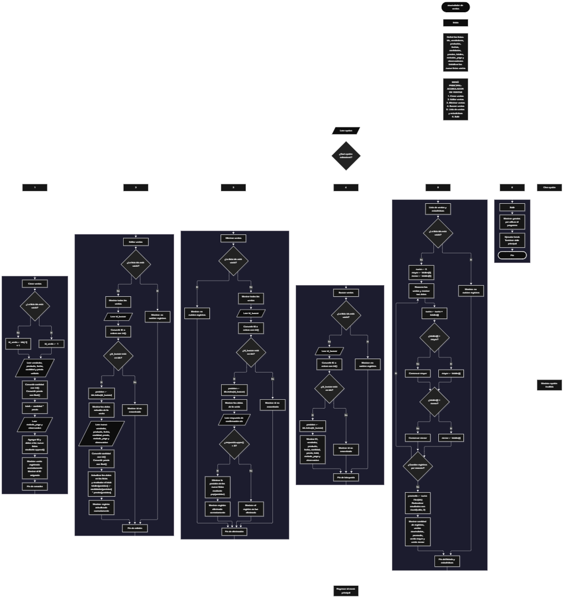

 

Este proyecto, llamado <b>acumulador de ventas</b>, fue desarrollado en <b>python</b> como un ejercicio práctico para fortalecer la lógica de programación mediante la creación de un sistema de gestión y análisis de ventas desde la consola. El programa cuenta con un menú principal de seis opciones que permite <b>crear, editar, eliminar, buscar y listar ventas, además de consultar estadísticas</b> sobre los registros almacenados. Cada venta contiene información como el identificador, el nombre del vendedor, el producto, la fecha, la cantidad vendida, el precio unitario, el importe total, el método de pago y las observaciones. Para organizar esta información, se utilizan <b>nueve listas paralelas</b> que mantienen los datos relacionados mediante posiciones correspondientes durante la ejecución del programa. Durante su desarrollo se aplicaron conceptos fundamentales de programación, como variables, listas, estructuras condicionales, ciclos repetitivos, operadores aritméticos, conversión de tipos de datos y métodos para agregar, buscar, modificar y eliminar registros. También se implementaron cálculos para obtener las ventas acumuladas, el promedio, la venta de mayor importe y la venta de menor importe. Este proyecto permite poner en práctica los conocimientos adquiridos en Python y sirve como base para desarrollar sistemas de gestión comercial más completos utilizando otros lenguajes y tecnologías.

<h2 align="center">⚙️ Funcionamiento del menú principal</h2>

### ➕ Crear ventas

La opción <b>1) crear ventas</b> permite registrar una nueva venta en el sistema. Antes de almacenar los datos, el programa comprueba si la lista <b>ids</b> está vacía mediante la condición <b>len(ids) == 0</b>. Si no existen registros, asigna el identificador <b>1</b> a la primera venta. En caso contrario, obtiene el último identificador almacenado mediante <b>ids[-1]</b> y le suma uno para generar el siguiente ID. Después, solicita el <b>nombre del vendedor, nombre del producto, fecha de la venta, cantidad vendida, precio unitario, método de pago y observación</b>. La cantidad se convierte a un número entero mediante <b>int()</b>, mientras que el precio unitario se convierte a un número decimal mediante <b>float()</b>. A continuación, calcula el importe total mediante la operación <b>total = cantidad * precio</b>. Finalmente, utiliza el método <b>append()</b> para agregar el identificador y los datos correspondientes a las nueve listas paralelas, muestra el mensaje <b>"venta registrada correctamente."</b> y presenta el ID asignado. Esta operación permite almacenar los datos de cada venta y calcular automáticamente su importe total.

### ✏️ Editar ventas

La opción <b>2) editar ventas</b> permite modificar la información de una venta registrada. Primero, el programa comprueba si la lista <b>ids</b> está vacía. Si no existen registros, muestra el mensaje <b>"no existen registros."</b>. En caso contrario, presenta todas las ventas almacenadas mediante un ciclo <b>for</b>, mostrando el identificador, vendedor, producto, fecha, cantidad, precio unitario, total, método de pago y observación. Después, solicita el identificador del registro que se desea editar y convierte el valor introducido a un número entero mediante <b>int()</b>. El programa comprueba si el ID se encuentra en la lista <b>ids</b> utilizando la condición <b>id_buscar in ids</b>. Si existe, obtiene su posición mediante <b>ids.index(id_buscar)</b> y muestra los datos actuales de la venta. A continuación, solicita el nuevo vendedor, producto, fecha, cantidad, precio unitario, método de pago y observación, actualizando directamente los valores de las listas correspondientes. Después de modificar la cantidad y el precio, recalcula el importe mediante <b>totales[posicion] = cantidades[posicion] * precios[posicion]</b>. Finalmente, muestra el mensaje <b>"registro actualizado correctamente."</b>. Si el ID no se encuentra en la lista, presenta el mensaje <b>"id no encontrada."</b>. El identificador original se conserva durante la edición.

### 🗑️ Eliminar ventas

La opción <b>3) eliminar ventas</b> permite eliminar una venta registrada mediante su identificador. Antes de comenzar, el programa comprueba si existen registros almacenados. Si la lista <b>ids</b> está vacía, muestra el mensaje <b>"no existen registros."</b>. Si hay ventas disponibles, utiliza un ciclo <b>for</b> para presentar todos los registros. Después, solicita el ID de la venta que se desea eliminar y comprueba si existe en la lista <b>ids</b>. Si encuentra una coincidencia, obtiene la posición mediante <b>ids.index(id_buscar)</b> y muestra los datos correspondientes a la venta seleccionada. A continuación, solicita una confirmación mediante la pregunta <b>"¿desea eliminar este registro? (s/n): "</b>. La respuesta se convierte a mayúsculas mediante <b>upper()</b> para comprobar si es igual a <b>"S"</b>, permitiendo confirmar la eliminación tanto con la letra s como con la letra S. Si el usuario confirma, el programa utiliza el método <b>pop(posicion)</b> para eliminar la venta de las nueve listas paralelas: <b>ids, vendedores, productos, fechas, cantidades, precios, totales, metodos_pago y observaciones</b>. Finalmente, muestra el mensaje <b>"registro eliminado correctamente."</b>. Si el usuario no confirma la operación, presenta el mensaje <b>"el registro no fue eliminado."</b>. Cuando el ID no existe, muestra <b>"id no encontrada."</b>. Esta operación mantiene alineados los datos de las listas al eliminar el registro de la misma posición.

### 🔎 Buscar ventas

La opción <b>4) buscar ventas</b> permite localizar una venta específica mediante su identificador. Primero, el programa comprueba si existen registros en la lista <b>ids</b>. Si no hay ventas almacenadas, presenta el mensaje <b>"no existen registros."</b>. En caso contrario, solicita el ID del registro que se desea consultar y convierte el dato introducido a un número entero mediante <b>int()</b>. Después, utiliza la condición <b>id_buscar in ids</b> para comprobar si el identificador existe. Si encuentra una coincidencia, obtiene la posición correspondiente mediante <b>ids.index(id_buscar)</b> y muestra la información completa de la venta: <b>ID, vendedor, producto, fecha, cantidad, precio unitario, total, método de pago y observación</b>. Si el identificador no se encuentra en la lista, presenta el mensaje <b>"id no encontrada."</b>. Esta función permite consultar individualmente una venta sin necesidad de recorrer manualmente todos sus datos.

### 📋 Lista de ventas y estadísticas

La opción <b>5) lista de ventas</b> permite visualizar todos los registros almacenados y obtener estadísticas sobre los importes de las ventas. Antes de iniciar el proceso, el programa comprueba si la lista <b>ids</b> está vacía. Si no existen registros, muestra el mensaje <b>"no existen registros."</b>. Si hay ventas disponibles, inicializa la variable <b>suma</b> en <b>0</b> y establece las variables <b>mayor</b> y <b>menor</b> con el primer importe almacenado en <b>totales[0]</b>. A continuación, utiliza un ciclo <b>for</b> para recorrer todas las ventas, mostrar sus datos y acumular los importes mediante la operación <b>suma += totales[i]</b>. Durante el recorrido, compara cada importe con los valores de <b>mayor</b> y <b>menor</b> para actualizar la venta de mayor y menor importe, respectivamente. Al finalizar, calcula el promedio mediante <b>promedio = suma / len(ids)</b>. Finalmente, muestra la cantidad de registros, las ventas acumuladas, el promedio de ventas, la venta mayor y la venta menor. Para presentar los resultados monetarios, utiliza <b>round(valor, 2)</b>, que redondea los valores numéricos a dos decimales. Esta opción permite consultar la información general de las ventas y conocer los principales indicadores calculados a partir de los registros existentes.

### 🚪 Salir del menú principal

La opción <b>6) salir</b> permite finalizar la ejecución del programa. Cuando el usuario selecciona esta opción, el programa muestra el mensaje <b>"gracias por utilizar el programa."</b> y ejecuta la instrucción <b>break</b>, que interrumpe el ciclo principal <b>while True</b>. De esta manera, el menú deja de repetirse y el programa termina su ejecución. Si el usuario introduce un valor que no coincide con ninguna de las seis opciones disponibles, la estructura condicional presenta el mensaje <b>"opción inválida."</b> y permite continuar utilizando el menú.

<h2 align="center">🧠 Temas aplicados en el proyecto</h2>

### 📦 Variables

En este proyecto se utilizan variables para almacenar temporalmente los datos de cada venta, controlar los identificadores, seleccionar los registros que se desean modificar o eliminar, calcular los importes y obtener estadísticas. Cada variable cumple una función específica dentro de las operaciones del sistema, permitiendo organizar la información y ejecutar los cálculos necesarios.

🆔 <b>ids:</b> Almacena los identificadores asignados a las ventas registradas.

👤 <b>vendedores:</b> Almacena los nombres de los vendedores.

📦 <b>productos:</b> Almacena los nombres de los productos vendidos.

📅 <b>fechas:</b> Almacena las fechas correspondientes a las ventas.

🔢 <b>cantidades:</b> Almacena las cantidades de unidades vendidas.

💲 <b>precios:</b> Almacena los precios unitarios de los productos.

🧮 <b>totales:</b> Almacena los importes totales calculados para cada venta.

💳 <b>metodos_pago:</b> Almacena los métodos de pago introducidos por el usuario.

📝 <b>observaciones:</b> Almacena las observaciones de cada venta.

🔄 <b>opcion:</b> Almacena la opción seleccionada en el menú principal.

🆔 <b>id_venta:</b> Almacena el identificador que se asignará a la nueva venta.

🔎 <b>id_buscar:</b> Almacena el ID introducido para localizar una venta.

📍 <b>posicion:</b> Guarda la posición de un registro encontrado en las listas.

🔢 <b>i:</b> Funciona como contador para recorrer las ventas almacenadas.

💰 <b>cantidad, precio y total:</b> Almacenan los valores utilizados para calcular el importe de una nueva venta.

📊 <b>suma:</b> Acumula los importes totales de las ventas.

📈 <b>promedio:</b> Almacena el promedio de los importes registrados.

⬆️ <b>mayor:</b> Almacena el importe más alto encontrado durante el recorrido.

⬇️ <b>menor:</b> Almacena el importe más bajo encontrado durante el recorrido.

### 🗃️ Listas paralelas

En este proyecto se utilizan nueve listas paralelas para almacenar los datos de las ventas. Todas comienzan vacías y se amplían durante la ejecución mediante el método <b>append()</b>. Cada posición representa una venta y contiene información relacionada en las nueve listas. Por ejemplo, los datos de una venta ubicada en la posición <b>0</b> se encuentran distribuidos entre <b>ids[0], vendedores[0], productos[0], fechas[0], cantidades[0], precios[0], totales[0], metodos_pago[0] y observaciones[0]</b>. Esta organización permite recorrer, buscar, editar, mostrar y eliminar los registros utilizando una posición común. Para mantener la correspondencia entre los datos, cada operación de registro y eliminación debe actuar sobre todas las listas relacionadas.

🆔 <b>ids:</b> Identificadores de los registros de ventas.

👤 <b>vendedores:</b> Nombres de los vendedores.

📦 <b>productos:</b> Productos vendidos.

📅 <b>fechas:</b> Fechas de las ventas.

🔢 <b>cantidades:</b> Unidades vendidas.

💲 <b>precios:</b> Precios unitarios.

🧮 <b>totales:</b> Importes calculados de las ventas.

💳 <b>metodos_pago:</b> Métodos de pago registrados.

📝 <b>observaciones:</b> Información adicional de cada venta.

### 🔀 Estructuras condicionales

En este proyecto se utilizan las estructuras <b>if, elif y else</b> para controlar el funcionamiento del menú principal y las operaciones de gestión. Las condiciones permiten determinar qué opción ha seleccionado el usuario, comprobar si existen registros antes de realizar una operación, verificar si un identificador se encuentra en la lista <b>ids</b> y decidir si una venta debe eliminarse según la confirmación recibida. También se utilizan comparaciones para determinar los importes de mayor y menor valor durante el cálculo de estadísticas. Estas estructuras permiten ejecutar diferentes instrucciones según las condiciones evaluadas.

### 🔄 Estructuras repetitivas

El programa utiliza los ciclos <b>while</b> y <b>for</b> para repetir instrucciones y recorrer los registros almacenados. El ciclo <b>while True</b> mantiene activo el menú principal hasta que se selecciona la opción de salida y se ejecuta <b>break</b>. Los ciclos <b>for</b> se utilizan para mostrar las ventas durante las operaciones de edición y eliminación, así como para recorrer todos los registros en la opción de estadísticas. Durante este último recorrido, el programa acumula los importes y compara los valores para identificar la venta mayor y la venta menor.

### 🎯 Selección de opciones

El programa utiliza una estructura condicional compuesta por <b>if, elif y else</b> para evaluar la variable <b>opcion</b>. Cada condición corresponde a una de las seis opciones del menú principal: crear ventas, editar ventas, eliminar ventas, buscar ventas, listar ventas y consultar estadísticas, o salir. Si el valor introducido no coincide con ninguna opción disponible, se ejecuta el bloque <b>else</b> y se muestra el mensaje <b>"opción inválida."</b>. Esta estructura permite organizar las operaciones y ejecutar únicamente el bloque correspondiente a la selección realizada.

### 🆔 Generación y búsqueda de identificadores

El sistema utiliza la lista <b>ids</b> para asignar y localizar las ventas registradas. Cuando se crea una venta, comprueba si la lista está vacía y asigna el ID <b>1</b> si se trata del primer registro. En caso contrario, utiliza <b>ids[-1] + 1</b> para calcular el siguiente identificador a partir del último elemento almacenado. Para buscar una venta, utiliza el operador <b>in</b> para comprobar si el ID existe y el método <b>index()</b> para obtener la posición correspondiente. Este procedimiento se aplica durante las operaciones de edición, eliminación y búsqueda. Como el identificador se calcula a partir del último elemento de la lista, puede reutilizarse después de eliminar la última venta registrada.

### 🧮 Operadores aritméticos y cálculos monetarios

En este proyecto se utilizan operadores aritméticos para calcular los importes y las estadísticas de las ventas. El operador de multiplicación <b>*</b> permite obtener el total de cada venta a partir de la cantidad y el precio unitario. El operador de suma <b>+</b> se utiliza para generar el siguiente identificador y acumular los importes mediante <b>suma += totales[i]</b>. El operador de división <b>/</b> permite calcular el promedio de ventas. Además, se utilizan operadores de comparación como <b>&gt;</b> y <b>&lt;</b> para identificar los importes de mayor y menor valor. Finalmente, la función <b>round()</b> se utiliza para redondear los resultados monetarios a dos decimales durante su presentación.

### 🔤 Conversión de tipos de datos

El programa utiliza las funciones <b>int()</b> y <b>float()</b> para convertir los valores introducidos por el usuario a tipos numéricos. La función <b>int()</b> se utiliza para convertir la cantidad de unidades vendidas y los identificadores introducidos durante las operaciones de edición, eliminación y búsqueda. Por su parte, <b>float()</b> permite almacenar el precio unitario como un número decimal. Estas conversiones hacen posible realizar operaciones aritméticas con los datos. Sin embargo, el programa no incorpora un tratamiento de errores para entradas que no puedan convertirse correctamente, por lo que un valor no numérico puede interrumpir la ejecución.

### 🛠️ Métodos y funciones de Python

El proyecto utiliza métodos y funciones integrados de Python para administrar las listas y procesar la información. El método <b>append()</b> agrega nuevos datos al final de cada lista, mientras que <b>pop(posicion)</b> elimina los elementos de la posición correspondiente durante la eliminación de una venta. El método <b>index()</b> permite localizar la posición de un identificador y <b>len()</b> devuelve la cantidad de registros almacenados. El operador <b>in</b> comprueba la existencia de un ID, mientras que <b>upper()</b> convierte la respuesta de confirmación a mayúsculas. También se utilizan las funciones <b>int()</b>, <b>float()</b> y <b>round()</b> para convertir datos y presentar los resultados numéricos.

### 📊 Cálculo de estadísticas

El programa incorpora un procedimiento estadístico que analiza los importes almacenados en la lista <b>totales</b>. Primero, inicializa la suma en cero y establece los valores de mayor y menor importe utilizando el primer elemento de la lista. Después, recorre las ventas mediante un ciclo <b>for</b>, acumula los importes y compara cada valor con los máximos y mínimos actuales. Una vez terminado el recorrido, divide la suma entre la cantidad de registros para obtener el promedio. Finalmente, presenta la cantidad de ventas, el importe acumulado, el promedio, la venta mayor y la venta menor. Este procedimiento permite obtener un resumen de los datos sin utilizar bibliotecas estadísticas externas.

<h2 align="center">¿Cómo se implementaron las operaciones crud en el proyecto?</h2>

Las operaciones <b>crud</b> se implementaron mediante las opciones del menú principal y permiten administrar las ventas registradas. La operación <b>crear</b> corresponde a la opción <b>1) crear ventas</b>, donde se solicitan los datos de una nueva venta, se calcula el importe total y se almacenan los valores en las nueve listas. La operación <b>leer</b> se realiza mediante las opciones <b>4) buscar ventas</b> y <b>5) lista de ventas</b>, que permiten consultar un registro individual o visualizar todas las ventas junto con sus estadísticas. La operación <b>actualizar</b> corresponde a <b>2) editar ventas</b>, donde se modifican los datos de una venta y se recalcula su importe total. Por último, la operación <b>eliminar</b> se realiza mediante <b>3) eliminar ventas</b>, que solicita confirmación y elimina el registro de todas las listas paralelas. Estas operaciones utilizan variables, listas, condicionales, ciclos y métodos de Python para gestionar la información almacenada temporalmente durante la ejecución del programa.

<h2 align="center">Diagrama de flujo del proyecto</h2>

<h2 align="center">🛡️ Validaciones del programa</h2>

### 📭 No existen registros

Esta comprobación se utiliza en las opciones de <b>editar, eliminar, buscar y listar ventas</b>. El programa verifica si la lista <b>ids</b> está vacía mediante la condición <b>len(ids) == 0</b>. Si no existen registros, muestra el mensaje <b>"no existen registros."</b> y evita continuar con las operaciones que necesitan datos almacenados. Esta comprobación permite informar al usuario cuando todavía no hay ventas registradas o cuando todos los registros han sido eliminados.

### 🔎 Identificador no encontrado

Esta comprobación se utiliza durante las operaciones de <b>editar, eliminar y buscar ventas</b>. Después de solicitar el identificador, el programa utiliza la condición <b>id_buscar in ids</b> para verificar si se encuentra en la lista. Si existe, obtiene su posición mediante <b>ids.index(id_buscar)</b> y continúa con la operación correspondiente. Si no existe, muestra el mensaje <b>"id no encontrada."</b>. De esta manera, el programa distingue entre los identificadores registrados y aquellos que no corresponden a ninguna venta almacenada.

### ⚠️ Confirmación de eliminación

Durante la eliminación de una venta, el programa solicita una respuesta mediante la pregunta <b>"¿desea eliminar este registro? (s/n): "</b>. Después, utiliza <b>respuesta.upper() == "S"</b> para comprobar si el usuario confirmó la operación. Si la respuesta es afirmativa, elimina los datos de la posición correspondiente en las nueve listas. Si la respuesta es diferente de <b>"S"</b> después de convertirla a mayúsculas, muestra el mensaje <b>"el registro no fue eliminado."</b>. Esta comprobación permite cancelar la eliminación antes de modificar las listas.

### 🔢 Conversión de datos numéricos

El programa utiliza <b>int()</b> para convertir las cantidades y los identificadores introducidos por el usuario, y <b>float()</b> para convertir los precios unitarios. Estas conversiones son necesarias para realizar las operaciones aritméticas y localizar los registros mediante sus identificadores numéricos. Sin embargo, el código no utiliza estructuras <b>try/except</b> para capturar errores de conversión. Si se introduce texto u otro valor incompatible con el tipo numérico esperado, Python puede generar una excepción y detener la ejecución del programa.

### 💲 Cálculo del importe total

El importe total de una venta se calcula multiplicando la cantidad vendida por el precio unitario mediante la operación <b>cantidad * precio</b>. Este cálculo se realiza durante la creación de una venta y se repite cuando se modifica la cantidad o el precio unitario en la opción de edición. El programa actualiza el valor de la lista <b>totales</b> utilizando los datos modificados. No obstante, no se comprueba que la cantidad sea positiva ni que el precio unitario sea mayor que cero, por lo que actualmente se pueden introducir valores negativos o precios iguales a cero.

### ⚠️ Identificadores y almacenamiento temporal

El programa genera los identificadores a partir del último elemento de la lista <b>ids</b>, por lo que no mantiene un contador independiente de los identificadores utilizados históricamente. Si se elimina la última venta registrada, el siguiente identificador puede reutilizarse. Además, todas las ventas se almacenan en listas que existen únicamente durante la ejecución del programa. Como no se utilizan archivos, bases de datos ni mecanismos de persistencia, los registros se pierden cuando finaliza la ejecución. Estas son limitaciones del funcionamiento actual y no validaciones implementadas.

### ❌ Opción inválida

El menú principal utiliza una estructura condicional para comprobar la opción introducida por el usuario. Si el valor de <b>opcion</b> no coincide con ninguna de las seis opciones definidas, se ejecuta el bloque <b>else</b> y se muestra el mensaje <b>"opción inválida."</b>. Después, el ciclo <b>while True</b> continúa y vuelve a presentar el menú principal. De esta manera, el usuario puede seleccionar otra opción sin necesidad de iniciar nuevamente el programa.

<h2 align="center">🎯 Objetivo del proyecto</h2>

El objetivo principal de este proyecto es fortalecer la <b>lógica de programación</b> mediante el desarrollo de un sistema de gestión y análisis de ventas en <b>python</b>. A través de su construcción se busca aplicar los conocimientos adquiridos sobre variables, listas, estructuras condicionales, ciclos repetitivos, operadores aritméticos, conversión de tipos y métodos de manipulación de datos. Además, el proyecto permite comprender cómo registrar, consultar, modificar y eliminar información, calcular automáticamente los importes de las ventas y obtener estadísticas básicas a partir de los registros almacenados. De esta manera, se establece una base para desarrollar sistemas comerciales más completos que incorporen validaciones adicionales, almacenamiento permanente y herramientas de análisis más avanzadas.

